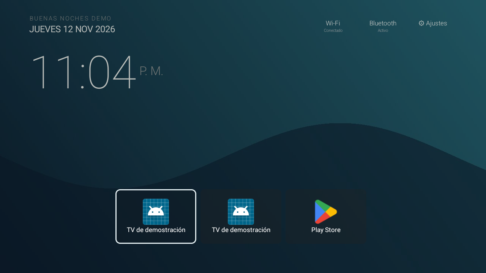
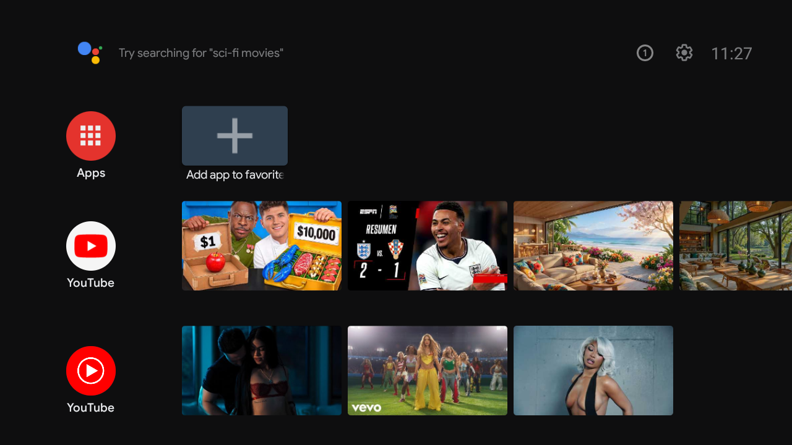
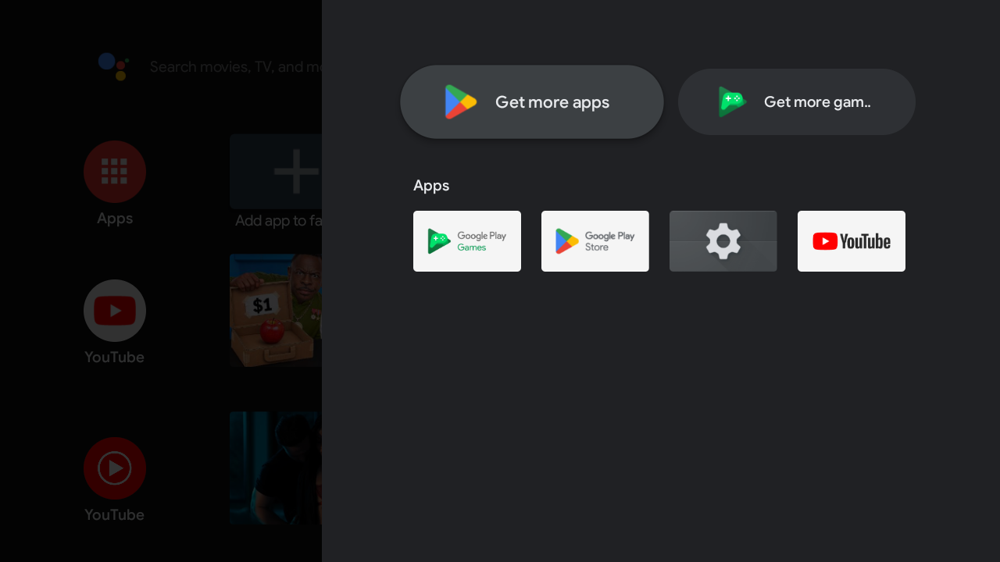
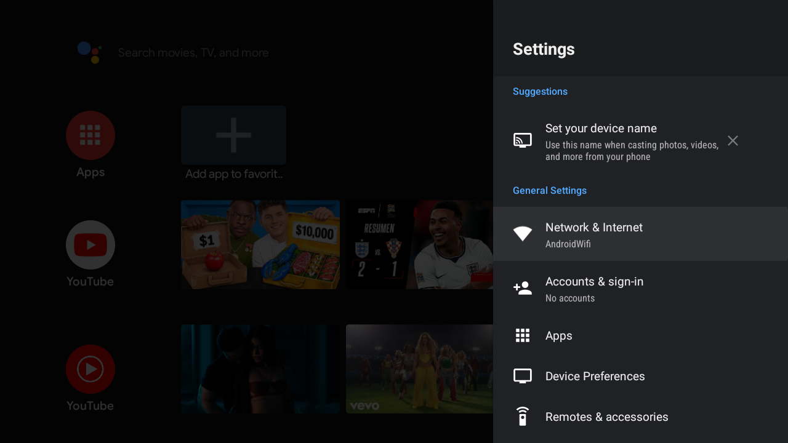
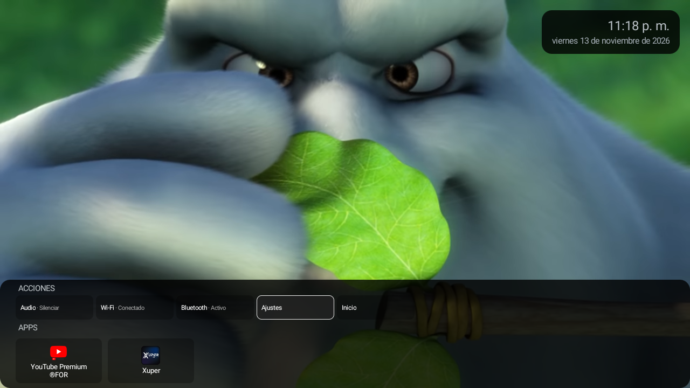
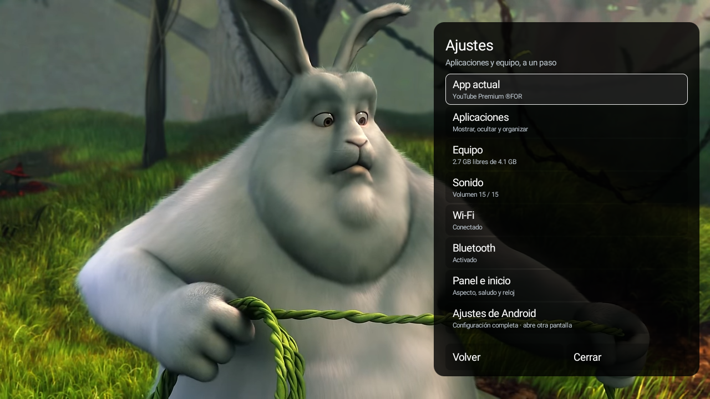
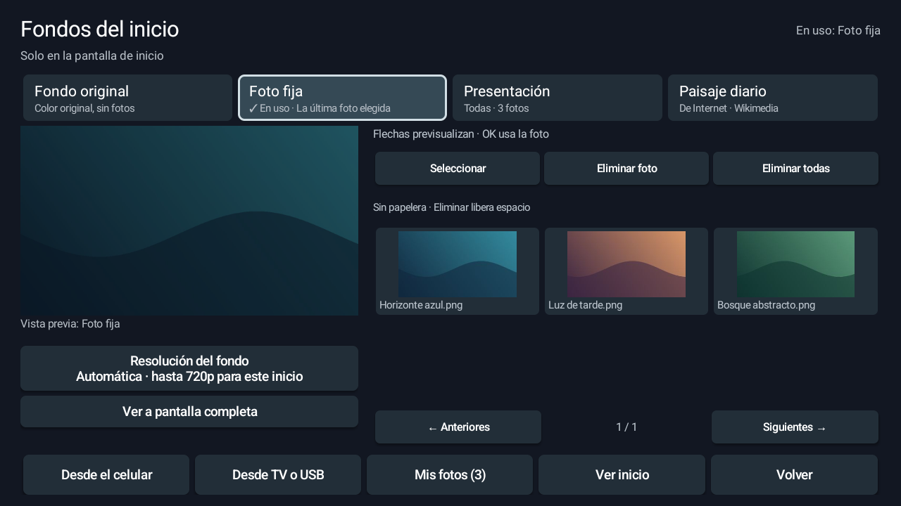
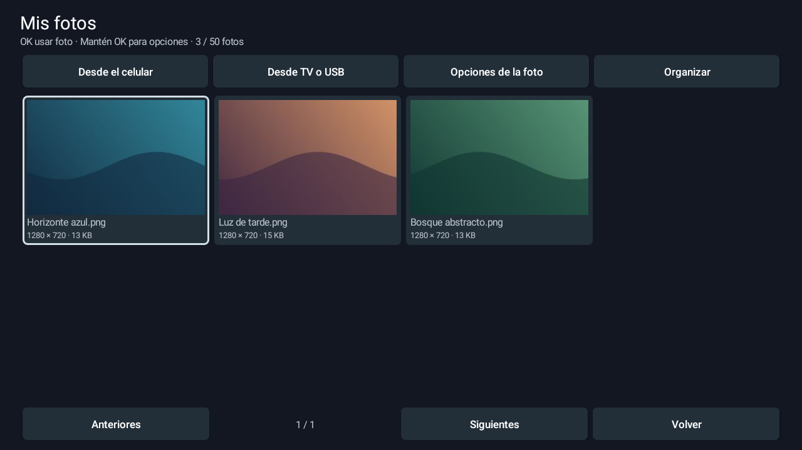
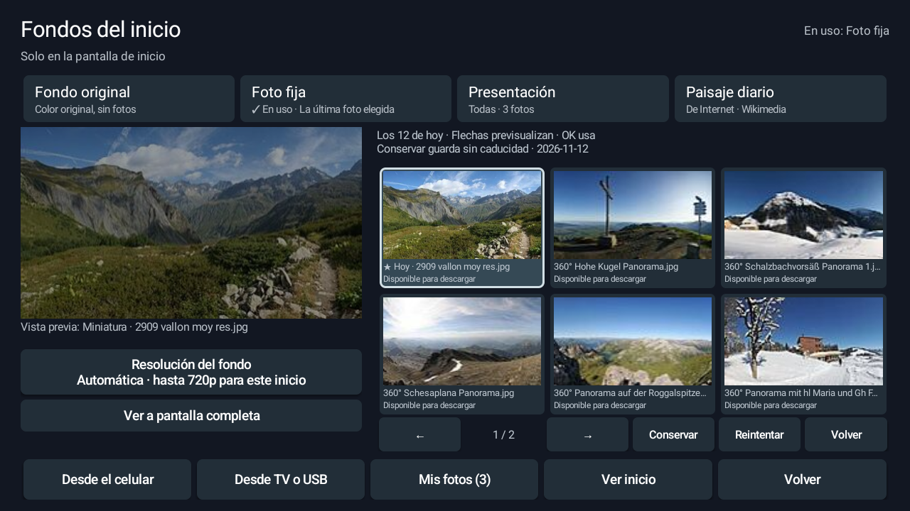
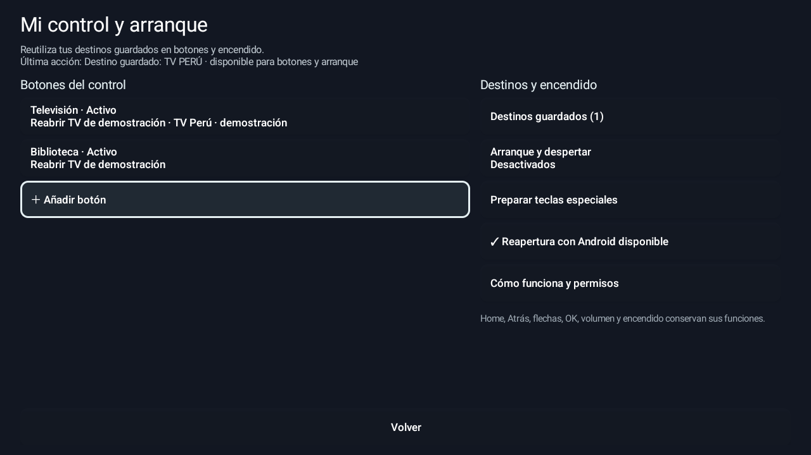

# Inicio y Panel TV

**Tu inicio, tus aplicaciones y tu control.**

Un inicio personalizable y un panel superpuesto para Android TV. Organiza tus aplicaciones, consulta la hora sobre el video, cambia el fondo y configura los botones del control desde un mismo entorno.

[](https://github.com/AntoniTito/Inicio-y-Panel-TV/releases/latest)
[](LICENSE)
[](docs/INSTALACION.md)

**[Descargar el paquete completo](https://github.com/AntoniTito/Inicio-y-Panel-TV/releases/latest) · [Instalar paso a paso](docs/INSTALACION.md) · [Replicar con una IA](docs/PROMPT-REPLICA.md) · [Compatibilidad](docs/COMPATIBILIDAD.md)**



*Captura real de 0.20.2 en un emulador Android TV 12, a 1280 × 720, con datos de demostración. Las capturas no representan una certificación de otros dispositivos.*

## Lo que puedes hacer

| Función | Cómo te ayuda |
|---|---|
| **Inicio organizado** | Mostrar, ocultar y ordenar apps. Añadir la primera aunque no haya tarjetas visibles. |
| **Panel sobre las aplicaciones** | Home abre apps y acciones sin abandonar el video durante las tareas que no lo interrumpen. |
| **Control con flechas** | Filas circulares independientes, foco visible y edición de apps con OK sostenido. |
| **Hora y ajustes rápidos** | Reloj y fecha opcionales, volumen, conexiones y acceso a Ajustes de Android. |
| **Fondos a tu gusto** | Foto fija, presentación y hasta 12 paisajes diarios de Wikimedia. |
| **Fotos desde el celular** | QR temporal en la misma red, copia optimizada en el TV y biblioteca con miniaturas y borrado. |
| **Tu control, tus acciones** | Etiquetas editables, abrir/reabrir apps y destinos reutilizables en teclas compatibles. |
| **Arranque y despertar** | Abrir la app y el destino configurados cuando Android informa esos eventos. |
| **Mantenimiento y recuperación** | Diagnóstico de capacidades, temporizador de suspensión y respaldo de ajustes antes de instalar. |

El diseño conserva cachés acotadas, trabajo pesado fuera de la interfaz y actualizaciones por eventos. No utiliza fondos de video ni transiciones de imágenes. [Conoce su arquitectura](docs/ARQUITECTURA.md).

## Antes: Android TV de fábrica

Estas son las interfaces nativas del emulador Android TV 12 usado como referencia: su inicio, la lista de aplicaciones y los ajustes de Android.



| Aplicaciones de fábrica | Ajustes nativos de Android TV |
|---|---|
|  |  |

*Capturas reales de un emulador Android TV 12/API 31, a 1280 × 720. El inicio y las apps de fábrica varían según el fabricante. [Ver procedencia y detalles](docs/ANDROID-TV-DE-FABRICA.md).*

## Después: con Inicio y Panel TV

El proyecto incorpora el inicio personalizable, el panel sobre las aplicaciones y sus ajustes rápidos. Los ajustes nativos de Android continúan disponibles desde **Ajustes de Android**.

| Panel sobre YouTube FOR | Ajustes superpuestos |
|---|---|
|  |  |
| **Fondos y vista previa** | **Mis fotos** |
|  |  |
| **Los paisajes de hoy** | **Mi control y arranque** |
|  |  |

*Panel y Ajustes: capturas del TV Box real sobre YouTube FOR. Video: Big Buck Bunny, © 2008 Blender Foundation. [Procedencia](docs/CAPTURAS.md#panel-superpuesto) · [Créditos y licencia](docs/CREDITOS-CAPTURAS.md#video-de-las-capturas-superpuestas).*

[Ver todas las interfaces actuales y sus explicaciones](docs/CAPTURAS.md).

## Antes de instalar

- **Android 10/API 29 o Android TV 12/API 31.** El asistente bloquea otras API hasta su adaptación y validación.
- **PC con Windows y PowerShell 5.1 o posterior**, conexión ADB autorizada y un control para completar las pruebas.
- La instalación usa el APK firmado: **no necesita Android Studio, Java ni la clave privada**.
- Apps externas, sus APK, cuentas y licencias se proporcionan por separado.

La marca del TV Box no basta para determinar compatibilidad. Home, teclas especiales, suspensión y auxiliar dependen del firmware. La evidencia del TV físico Android 10 corresponde a versiones anteriores; las pruebas nuevas de 0.20.2 se registran por separado en [el informe de la entrega](docs/VERIFICACION-0.20.2.md). [Consulta la matriz completa](docs/COMPATIBILIDAD.md).

## Instalación rápida

1. Descarga **`Inicio-y-Panel-TV-0.20.2-portable.zip`** desde [Releases](https://github.com/AntoniTito/Inicio-y-Panel-TV/releases/latest) y extráelo. Contiene código, guías y los dos APK firmados. El ZIP automático «Source code» de GitHub no contiene los APK.
2. Activa las opciones de desarrollador y la depuración compatibles con tu TV Box. Conecta y autoriza el PC; utiliza la IP/puerto o serial real del destino.
3. Abre PowerShell en la carpeta extraída. Prepara ADB y revisa el destino:

```powershell
powershell -NoProfile -ExecutionPolicy Bypass -File .\herramientas\preparar-herramientas.ps1 -SoloAdb
powershell -NoProfile -ExecutionPolicy Bypass -File .\z6.ps1 instalar -Dispositivo IP:PUERTO -Simular
powershell -NoProfile -ExecutionPolicy Bypass -File .\z6.ps1 diagnosticar -Dispositivo IP:PUERTO
```

4. Instala el panel. `-SoloPanel` permite añadir después las aplicaciones externas:

```powershell
powershell -NoProfile -ExecutionPolicy Bypass -File .\z6.ps1 instalar -Dispositivo IP:PUERTO -Perfil replica -SoloPanel
```

5. Completa las autorizaciones que muestre Android. En Ajustes, organiza tus apps, elige el fondo y configura **Aplicaciones → Mi control y arranque**. Comprueba el resultado con tu control.

El asistente conserva un respaldo por dispositivo y verifica Inicio y Panel TV como HOME antes de deshabilitar reversiblemente el inicio anterior. Configurar botones y destinos requiere pasos adicionales en el TV. [Guía completa de instalación y recuperación](docs/INSTALACION.md).

## Personaliza tu TV

- **Panel e inicio:** reloj superior, formato de hora, saludo y aspecto.
- **Fondos del inicio:** foto, presentación, paisajes, recepción del celular y TV/USB. La resolución se adapta al área real de Inicio y a la memoria; la salida HDMI no determina por sí sola la resolución de la interfaz.
- **Mi control y arranque:** identifica una tecla, ponle nombre y elige su acción. Abrir o reabrir una app no requiere seleccionar un canal.
- **Destinos guardados:** enseña un recorrido navegando dentro de la app, pruébalo y guárdalo. Después reutilízalo en botones y arranque/despertar.

[Fondos y fotos](docs/FONDOS.md) · [Navegación del panel](docs/PANEL-SUPERPUESTO.md) · [Botones y destinos](docs/DESTINOS-Y-BOTONES.md).

## Replicar el entorno con una IA

Entrega a tu agente el [prompt único](docs/PROMPT-REPLICA.md), la [guía de réplica](docs/REPLICAR-ENTORNO.md) y los [14 requisitos obligatorios](docs/CONTRATO-REPLICA.md). Las instrucciones exigen completar y demostrar cada requisito: instalar el APK o documentar una limitación no equivale a una réplica terminada.

Los valores propios del nuevo equipo se configuran allí. No se distribuyen cuentas, autorizaciones, fotos ni recorridos privados. Una restricción demostrada que impida una función deja la réplica incompleta; no se promete identidad en cualquier hardware.

## Si algo no funciona

| Situación | Qué revisar |
|---|---|
| Home no abre el panel | Servicio principal de Accesibilidad, HOME seleccionado y política del firmware. |
| Un botón no se detecta | Identidad que entrega Android y preparación de teclas compatibles; los logos del control no identifican el código. |
| Una app no aparece | Debe estar instalada y tener una actividad de inicio; comprueba también apps ocultas. |
| El destino no quedó guardado | Completa la prueba y confirma **Guardar destino**; revisa el borrador pendiente. |
| El celular no abre el QR | Misma red que el TV, pantalla de recepción abierta y QR actual. La red privada del emulador no es accesible directamente desde el celular. |
| Falta una función avanzada | **Equipo → Diagnóstico y permisos** muestra la capacidad y autorización pendientes. |

[Permisos, auxiliar y privacidad](docs/PERMISOS-Y-PRIVACIDAD.md). La autorización del PC para instalar no significa que deba reactivarse la depuración por cada uso de un botón.

## Recuperar la configuración

```powershell
.\z6.ps1 restaurar -Dispositivo IP:PUERTO
# Para instalar además el APK de recuperación:
.\z6.ps1 restaurar -Dispositivo IP:PUERTO -RecuperarVersion
```

Usa solo el respaldo de ese equipo. La recuperación **0.20.1/c63** conserva el formato de fotos y destinos y vuelve a la marca anterior Z6 Panel. Después requiere **c64 o superior** para actualizar. No desinstales para forzar una versión anterior: podrías perder datos. [Detalles de recuperación](docs/INSTALACION.md).

## Para desarrolladores

Código Java con vistas nativas, herramientas Windows y pruebas con emuladores y ADB simulado. Los nombres técnicos `local.z6panel`, `z6.ps1` y `Pictures/Z6` se conservan para mantener compatibilidad; **Inicio y Panel TV es la continuación del mismo proyecto**.

[Arquitectura](docs/ARQUITECTURA.md) · [Compilación](docs/COMPILACION.md) · [Pruebas](pruebas/README.md) · [Versiones](docs/VERSIONES.md) · [Contribuir](CONTRIBUTING.md).

## Licencia y créditos

Código propio y documentación: **Copyright © 2026 Antoni**, bajo [GPL-3.0-only](LICENSE). Los componentes de terceros conservan sus licencias; la biblioteca QR Nayuki utiliza MIT. Las imágenes de Wikimedia tienen sus propios autores y licencias. [Avisos y créditos](docs/TERCEROS.md).

Las descargas oficiales usan la firma original. Las claves, SDK, respaldos y datos personales quedan fuera del repositorio y del portable.
