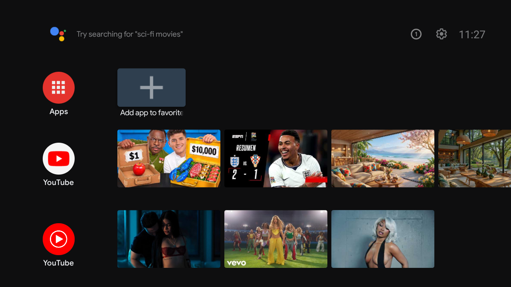
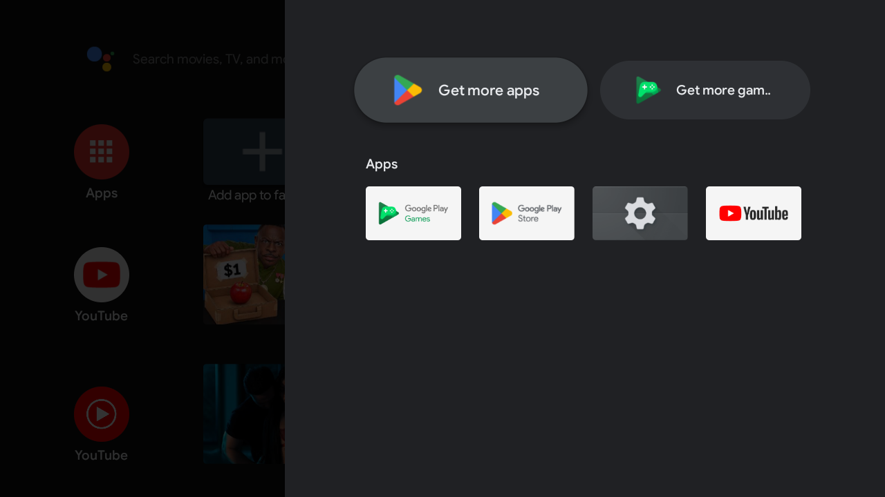
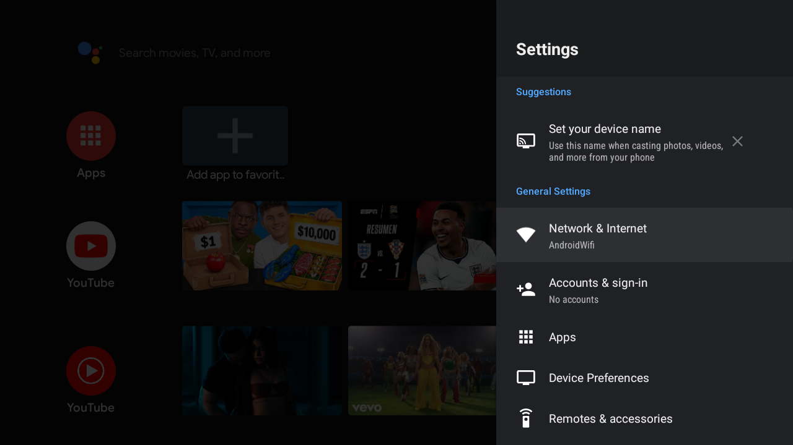

# Android TV de fábrica

Interfaces nativas de **Android TV 12/API 31**, obtenidas en el emulador de demostración existente, a **1280 × 720**. Permiten reconocer el entorno del sistema previo al uso de Inicio y Panel TV.

[Volver al README](../README.md#antes-android-tv-de-fábrica) · [Ver Inicio y Panel TV](CAPTURAS.md)

## Inicio

El launcher `com.google.android.tvlauncher`, incluido en la imagen oficial del emulador, muestra la búsqueda, el acceso a las aplicaciones y las filas de recomendaciones. Se reutilizó su captura de fábrica ya documentada.

## Aplicaciones

La pantalla nativa de aplicaciones del launcher reúne los accesos del sistema y sus enlaces a la tienda. Inicio y Panel TV y las dos apps de prueba estuvieron desactivados durante esta captura, dentro de una sesión temporal del emulador.

## Ajustes de Android TV

La pantalla nativa `com.android.tv.settings` muestra las categorías de configuración del sistema. La red «AndroidWifi» y el estado sin cuentas corresponden al entorno virtual de demostración.

Estos ajustes continúan disponibles después de instalar el proyecto, mediante **Ajustes de Android**. Inicio y Panel TV añade su propio menú de accesos y controles.

## Procedencia y alcance

Las imágenes muestran el aspecto real de la imagen oficial utilizada por el emulador. El inicio, las aplicaciones incluidas y la distribución de ajustes pueden variar entre fabricantes. Estas capturas no son del TV Box físico original ni documentan un restablecimiento de fábrica.

Para las dos capturas nuevas se reutilizó el emulador existente en una sesión de solo lectura y sin guardar snapshots. Se habilitó temporalmente el launcher nativo y se desactivaron el panel y las apps de demostración; al terminar se repusieron sus estados y se cerró la sesión. No se descargó otro emulador ni se modificó el TV Box físico.

Los nombres, iconos y recomendaciones conservan los derechos de sus titulares. [Créditos de las capturas](CREDITOS-CAPTURAS.md).
