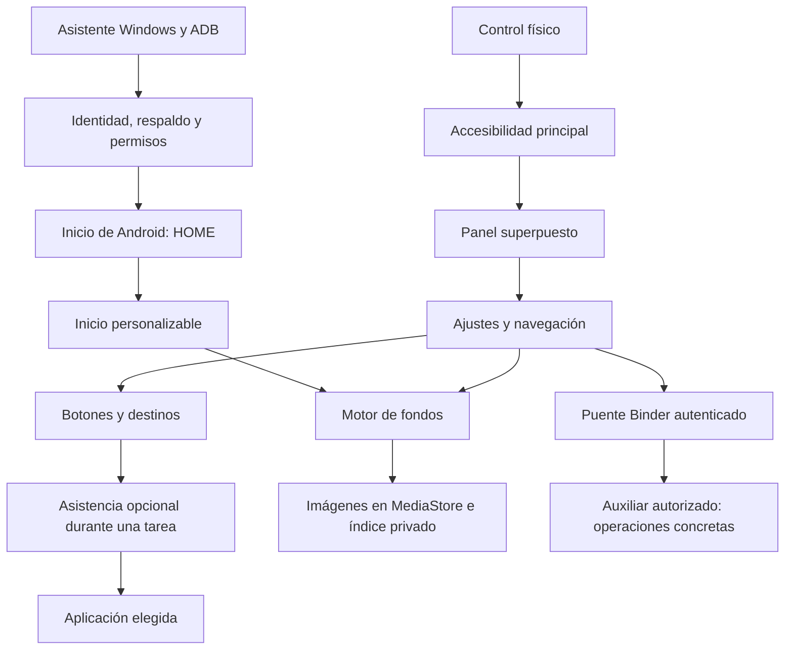

# Cómo funciona Inicio y Panel TV

Un mismo APK contiene el inicio, el panel superpuesto y las capacidades de personalización. El asistente de Windows prepara el destino; no necesita permanecer conectado para el uso normal de las funciones que el equipo permita ejecutar de forma autónoma.

## Responsabilidades

| Parte | Función |
|---|---|
| `app` | Inicio, panel, personalización, recepción, navegación y auxiliar. |
| `herramientas` y `z6.ps1` | Preparar dependencias, instalar, configurar, exportar y restaurar un destino explícito. |
| `perfiles` | Preferencias transferibles de apariencia y organización. Los perfiles locales no se publican. |
| `entregas/manifest.json` | Selección de APK actual/recuperación, versiones, certificado y hashes. |
| `pruebas` | ADB simulado, fixtures sintéticas y suites que exigen emulador explícito. |
| `docs` | Instalación, réplica, capacidades, evidencia e historial. |
| `privado` y `.local` | Firma, datos individuales, herramientas y archivos generados; excluidos de Git. |

## Navegación y rendimiento

El catálogo y los iconos se reutilizan y se invalidan por eventos de paquetes. El panel actualiza el resaltado anterior y el nuevo al navegar; no escribe una preferencia por cada flecha. Apps y Acciones son filas independientes, con memoria en proceso. La edición permanece en Apps.

El motor de fondos trabaja fuera del hilo de interfaz, conserva cachés acotadas y descarta respuestas antiguas. Inicio prepara primero la imagen local al volver, antes del mantenimiento y la red. Las descargas y rotaciones no se mantienen durante otras aplicaciones o suspensión. Las fotos compartidas se leen por URI, sin reconstruir una supuesta ruta física.

El auxiliar mantiene Binder y atiende pérdida de conexión por eventos con reintentos limitados. No hay un reenlace permanente cada 500 ms. Las operaciones autorizadas están delimitadas y autenticadas; no es una consola remota de comandos arbitrarios.

## Datos y compatibilidad

La versión 0.20.2 cambia la marca visible, manteniendo paquete, componentes, firma, preferencias, protocolos e índices. Los nombres internos `local.z6panel`, `z6remote`, `z6.ps1` y las carpetas `Pictures/Z6` siguen identificando los mismos datos. No se migran las fotos solo para cambiar un nombre.

Los destinos contienen referencias de controles, paquete y firma; no son una secuencia de coordenadas. Se guardan después de probar y confirmar. Los botones y el arranque tienen copias independientes de cada recorrido; la biblioteca permite reutilizarlo.

El instalador admite API 29/31. Las APIs mínimas declaradas en el APK no equivalen a una validación de todos los Android posteriores. Accesibilidad, Home, permisos, teclas y suspensión deben comprobarse en cada firmware. [Compatibilidad](COMPATIBILIDAD.md) · [Permisos y privacidad](PERMISOS-Y-PRIVACIDAD.md).
