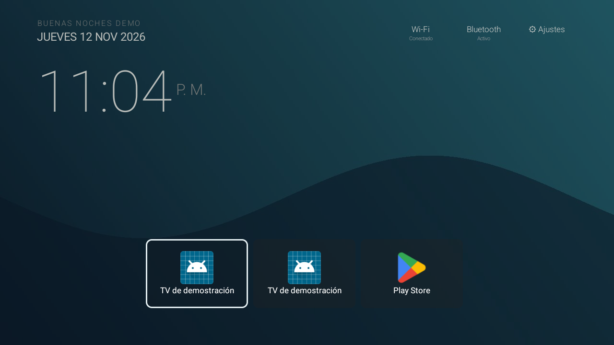
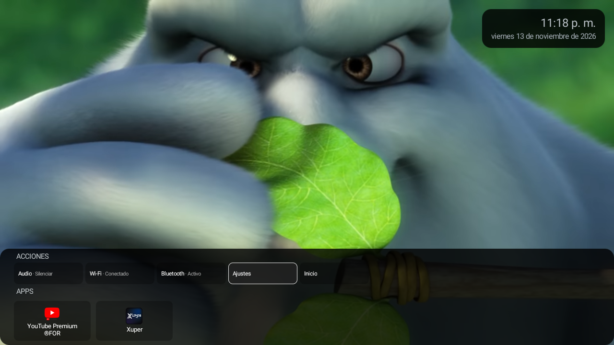
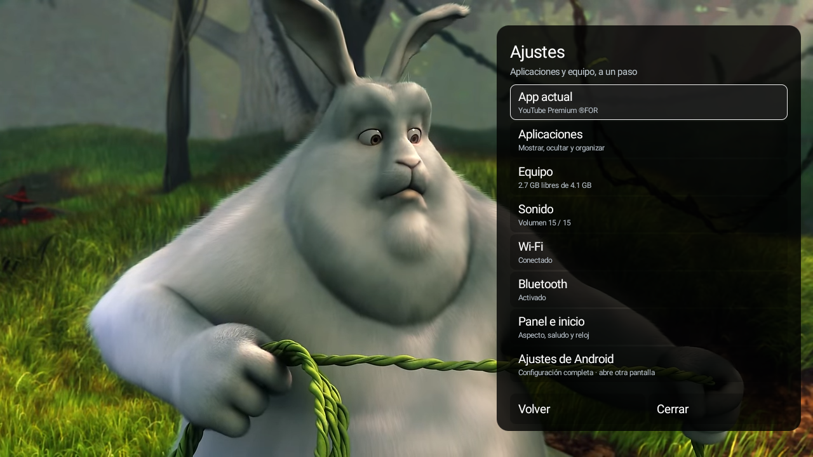
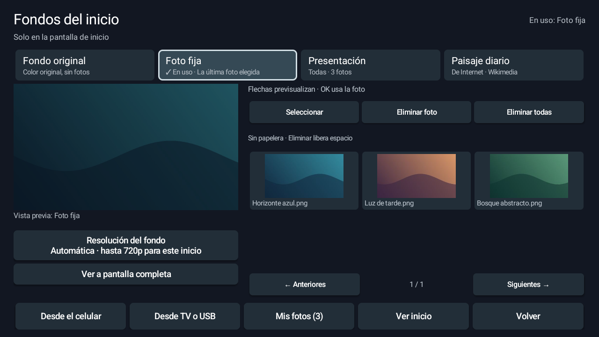
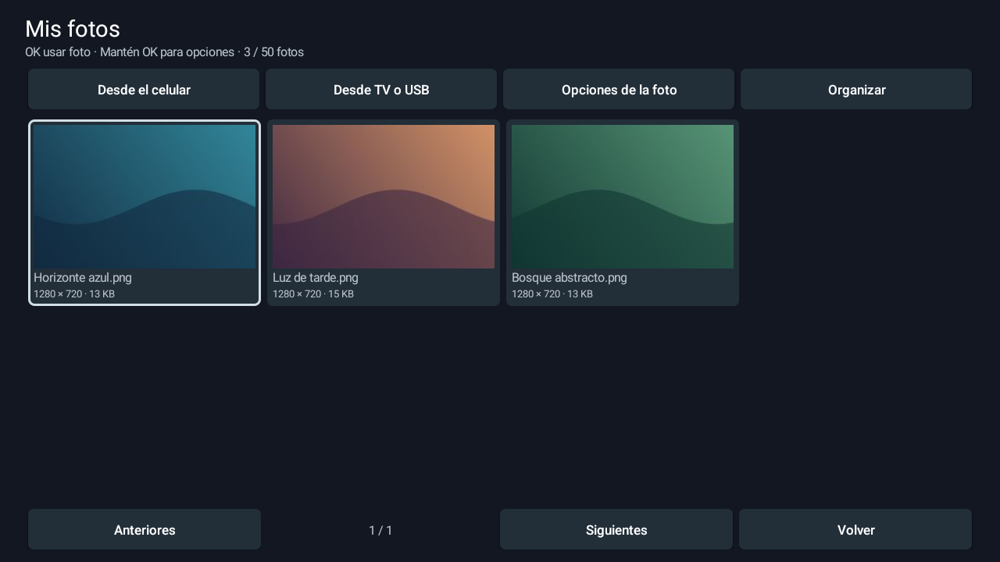

# Recorrido visual

Capturas reales de las interfaces del proyecto, a **1280 × 720**. La procedencia de cada grupo es:

| Capturas | Entorno | Versión instalada |
|---|---|---|
| Panel superpuesto y Ajustes | TV Box original, Android 10/API 29, con YouTube FOR reproduciendo un video | Z6 Panel 0.20.1/c60 |
| Inicio, Fondos, Mis fotos, Paisajes, Mi control y Destinos | Emulador Android TV 12/API 31 separado, con datos de demostración | Inicio y Panel TV 0.20.2/c62 |

Las dos capturas físicas se incorporaron después de publicar 0.20.2. El TV Box conserva 0.20.1, el nombre anterior del mismo proyecto; no se actualizó su APK ni se editaron sus preferencias para obtener estas imágenes. Su evidencia no se atribuye a una instalación física de 0.20.2.

Las imágenes del emulador usan nombres ficticios, aplicaciones de prueba y gráficos de demostración. Su auxiliar se inició desde ADB autorizado. Las capturas no prueban por sí solas recuperación autónoma tras reiniciar, rendimiento ni funcionamiento de un control Bluetooth.

Las interfaces nativas previas al uso del proyecto se consultan en [Android TV de fábrica](ANDROID-TV-DE-FABRICA.md). El archivo del desarrollo está separado en [Evolución del proyecto](EVOLUCION-DEL-PROYECTO.md).

## Inicio

Reloj, fecha, saludo, fondo y aplicaciones en la pantalla principal. La configuración de demostración usa una imagen abstracta propia.

## Panel superpuesto

Apps y Acciones tienen selección circular independiente. Arriba y abajo cambian de fila; la edición permanece en Apps. El reloj superior se puede desactivar.

La captura física muestra el panel inferior y el reloj sobre el video que el usuario dejó reproduciéndose en **YouTube Premium @FOR**. La aplicación de fondo permaneció abierta durante la captura. [Créditos del video](CREDITOS-CAPTURAS.md#video-de-las-capturas-superpuestas).

## Ajustes

Ocho entradas para aplicaciones, equipo, sonido, conexiones, personalización y los ajustes completos de Android. Las capacidades dependen de los permisos y del firmware.

El menú lateral se capturó sobre el mismo reproductor del TV Box. Al terminar se cerró la superposición, dejando la aplicación de video abierta.

## Fondos del inicio

Cuatro modos en una fila, vista previa y controles contextuales. Las flechas previsualizan; las elecciones se aplican con la acción correspondiente.

## Mis fotos

Miniaturas, información y organización. Las imágenes recibidas se guardan optimizadas en el TV; borrar desde el panel elimina su copia y miniaturas, sin papelera.

## Paisajes diarios

Hasta doce paisajes, con miniaturas persistentes durante el día, conservación permanente y rotación opcional. Las fotografías mantienen sus propias licencias, separadas de la GPL del código.

## Mi control y arranque

Cada botón tiene su aplicación, etiqueta y acción. Las teclas y recorridos de las capturas son sintéticos; no representan una asignación universal de Netflix o YouTube.

## Destinos guardados

Una sección probada puede reutilizarse en botones y arranque/despertar. Las acciones de usar y eliminar permanecen visibles junto a la lista.

## Recursos y créditos

Los tres gráficos abstractos de la biblioteca fueron generados para la demostración del emulador por el proyecto, sin usar fotos personales. Sus aplicaciones de prueba proceden de la fixture incluida en `pruebas/fixture-tv`. YouTube FOR es una aplicación externa del TV Box y no se incluye en el proyecto. Las capturas conservan la interfaz real; no son maquetas ni composiciones de un panel añadido a un fotograma.

Los créditos del video, las fotografías del catálogo y los avisos sobre las capturas históricas se registran en [CRÉDITOS DE LAS CAPTURAS](CREDITOS-CAPTURAS.md). Los paisajes se muestran como miniaturas o encuadres de la interfaz, sin incorporar una colección al APK.
