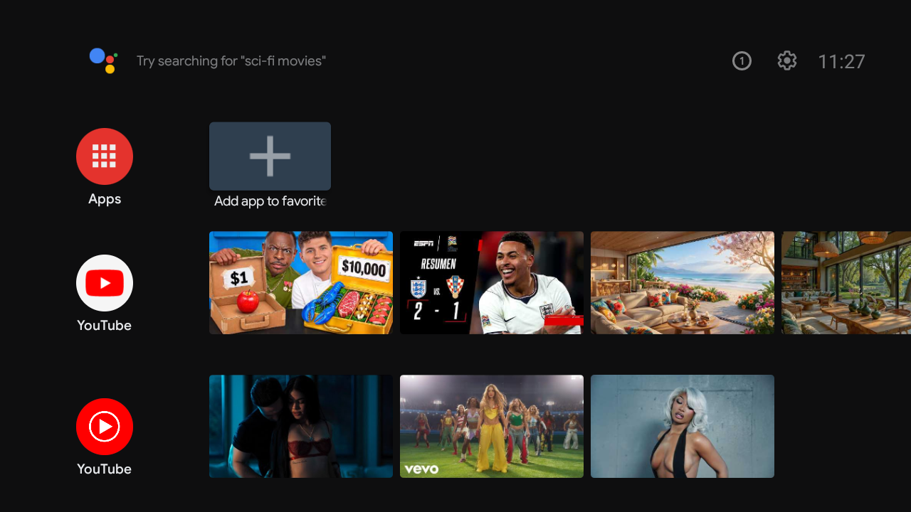
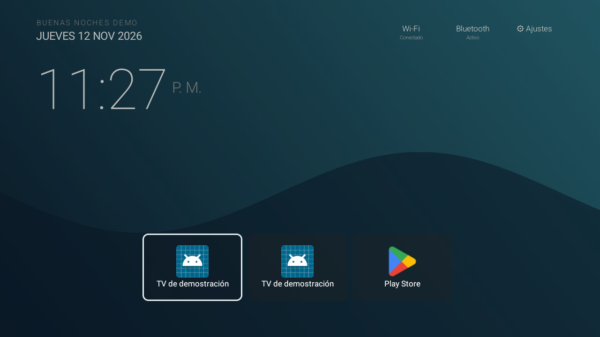
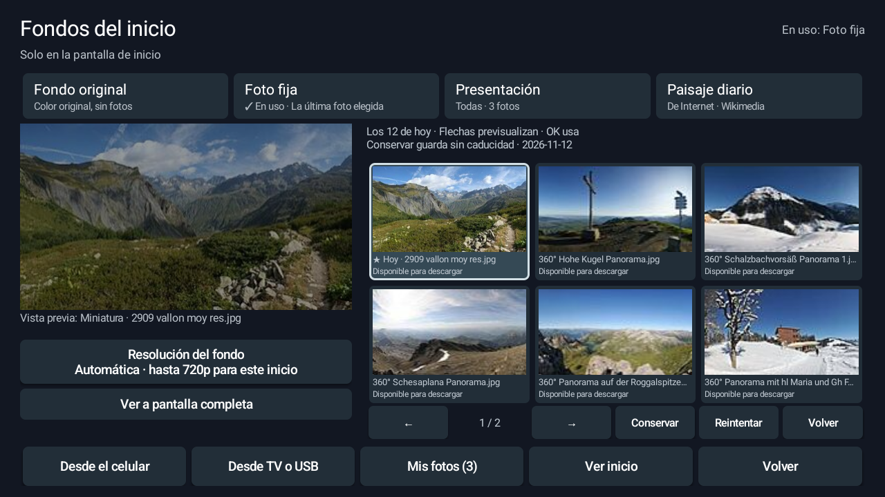
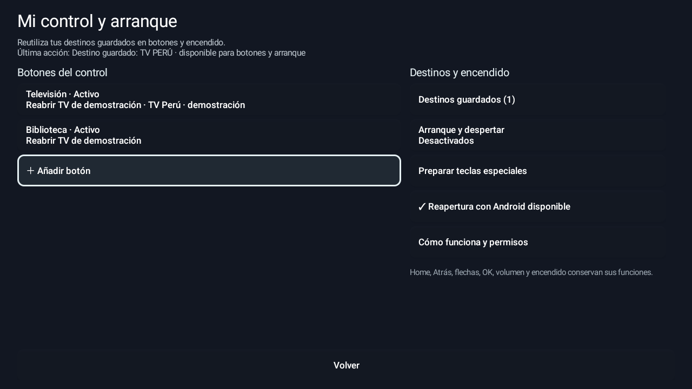

# Recorrido visual

Capturas reales obtenidas en un emulador Android TV 12/API 31 separado, a **1280 × 720**. La interfaz de Inicio y Panel TV corresponde a **0.20.2/c62**, con nombres ficticios, aplicaciones de prueba y gráficos de demostración. La comparación incluye también el inicio estándar de la imagen de Android TV. El auxiliar de la demostración se inició desde ADB autorizado; estas imágenes no prueban recuperación autónoma tras reiniciar. No son fotografías del TV Box original ni pruebas físicas de reproducción o de un control Bluetooth.

## Antes y después

Las dos imágenes siguientes se obtuvieron en la misma sesión del mismo emulador, con igual resolución:

| Antes · inicio de fábrica de Android TV | Después · Inicio y Panel TV 0.20.2 |
|---|---|
|  |  |

**Antes:** el launcher `com.google.android.tvlauncher`, incluido en la imagen oficial del emulador, abierto temporalmente para esta captura. Muestra su búsqueda, accesos y recomendaciones.

**Después:** el inicio de 0.20.2 con el fondo abstracto propio, reloj, fecha y aplicaciones de demostración. El [panel superpuesto](#panel-superpuesto) y los ajustes se muestran más abajo.

La comparación ilustra el cambio de interfaz en este entorno. El inicio de fábrica del TV Box original o de otra marca puede tener un aspecto distinto; estas imágenes no documentan un cambio de firmware ni una prueba física. Las recomendaciones visibles en el inicio estándar pertenecen a sus proveedores y no forman parte de Inicio y Panel TV.

Para obtenerlas se reutilizó el emulador de demostración existente en una sesión de solo lectura y sin guardar snapshots. Se conservó su launcher configurado y se cerró la sesión al terminar. No se descargó otro emulador ni se modificó el TV Box físico.

## Inicio

Reloj, fecha, saludo, fondo y aplicaciones en la pantalla principal. La configuración de demostración usa una imagen abstracta propia.

## Panel superpuesto

Apps y Acciones tienen selección circular independiente. Arriba y abajo cambian de fila; la edición permanece en Apps. El reloj superior se puede desactivar.

## Ajustes

Ocho entradas para aplicaciones, equipo, sonido, conexiones, personalización y los ajustes completos de Android. Las capacidades dependen de los permisos y del firmware.

## Fondos del inicio

Cuatro modos en una fila, vista previa y controles contextuales. Las flechas previsualizan; las elecciones se aplican con la acción correspondiente.

## Mis fotos

Miniaturas, información y organización. Las imágenes recibidas se guardan optimizadas en el TV; borrar desde el panel elimina su copia y miniaturas, sin papelera.

## Paisajes diarios

Hasta doce paisajes, con miniaturas persistentes durante el día, conservación permanente y rotación opcional. Las fotografías mantienen sus propias licencias, separadas de la GPL del código.

## Mi control y arranque

Cada botón tiene su aplicación, etiqueta y acción. Las teclas y recorridos de las capturas son sintéticos; no representan una asignación universal de Netflix o YouTube.

## Destinos guardados

Una sección probada puede reutilizarse en botones y arranque/despertar. Las acciones de usar y eliminar permanecen visibles junto a la lista.

## Recursos y créditos

Los tres gráficos abstractos de la biblioteca fueron generados para esta demostración por el proyecto, sin usar fotos personales. Las aplicaciones de demostración proceden de la fixture incluida en `pruebas/fixture-tv`. Las capturas conservan la interfaz real; no son maquetas generadas.

Los créditos de las fotografías visibles del catálogo y la atribución de la interfaz del inicio estándar se registran en [CRÉDITOS DE LAS CAPTURAS](CREDITOS-CAPTURAS.md). Los paisajes se muestran como miniaturas o encuadres de la interfaz, sin incorporar una colección al APK.
