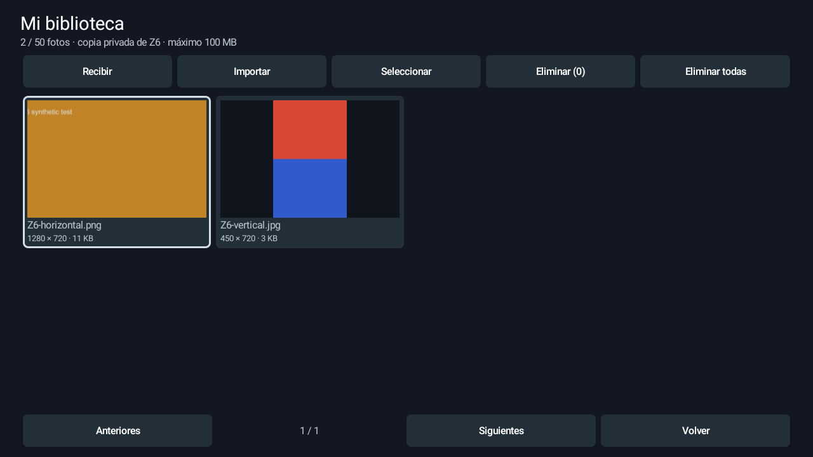
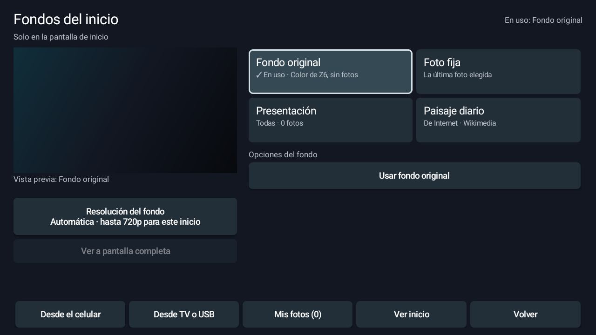
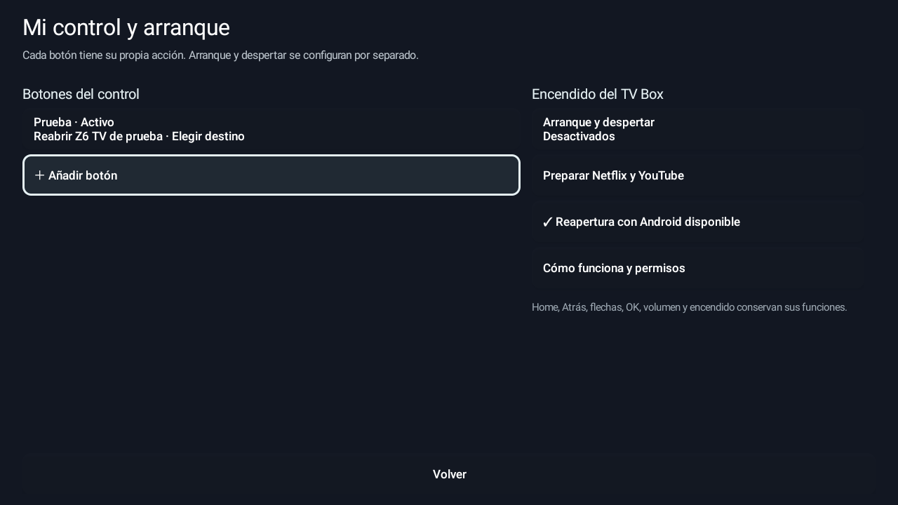

# Evolución del proyecto

Archivo visual de algunas interfaces anteriores de Z6 Panel, nombre del proyecto hasta 0.20.1. Estas capturas documentan la evolución del desarrollo. Las pantallas nativas del sistema se consultan por separado en [Android TV de fábrica](ANDROID-TV-DE-FABRICA.md).

[Volver a la presentación](../README.md) · [Ver las interfaces actuales](CAPTURAS.md) · [Consultar las versiones](VERSIONES.md)

## Contenido

- [Biblioteca de fotos · Z6 Panel 0.13.0](#biblioteca-de-fotos--z6-panel-0130).
- [Fondos del inicio · Z6 Panel 0.14.0](#fondos-del-inicio--z6-panel-0140).
- [Mi control y arranque · Z6 Panel 0.19.0](#mi-control-y-arranque--z6-panel-0190).

## Biblioteca de fotos · Z6 Panel 0.13.0

**Procedencia:** captura archivada de las pruebas del emulador API 31, a 1280 × 720, con dos imágenes sintéticas.

La biblioteca reunía los accesos a recibir, importar, seleccionar y eliminar sobre la cuadrícula de miniaturas. La cabecera identificaba el almacenamiento privado utilizado en esa etapa, anterior a la publicación de imágenes en MediaStore.

[Informe de esta versión](VERIFICACION-0.13.0.md).

## Fondos del inicio · Z6 Panel 0.14.0

**Procedencia:** captura archivada del primer diseño de 0.14.0 en emulador, a 1280 × 720, con la biblioteca vacía.

El diseño distribuía los cuatro modos en una cuadrícula de dos filas junto a la vista previa. Los accesos a recepción, importación y biblioteca permanecían en el pie. La fila única de modos y la gestión de fotos integrada llegaron después.

[Informe de esta versión](VERIFICACION-0.14.0.md).

## Mi control y arranque · Z6 Panel 0.19.0

**Procedencia:** captura archivada de las pruebas de 0.19.0 en emulador, a 1280 × 720, con una aplicación y un botón de prueba.

La pantalla separaba los botones del control de las opciones de arranque y despertar. Esta etapa precede a la biblioteca reutilizable de destinos y a su gestor de eliminación.

[Informe de esta versión](VERIFICACION-0.19.0.md).

## Alcance del archivo

Estas capturas documentan etapas diferentes del desarrollo. No representan una misma versión ni una prueba física de compatibilidad, reproducción o rendimiento. Las pruebas y sus límites están en los informes de cada entrega.

Se reutilizaron imágenes archivadas y se revisó su contenido antes de publicarlas. No se recrearon versiones antiguas ni se modificó el TV Box para completar este archivo.

[Créditos de las capturas](CREDITOS-CAPTURAS.md) · [Ver las interfaces actuales](CAPTURAS.md)
